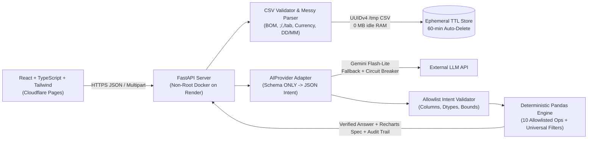

# AskGrid — *Don't Scroll, Just Ask.*

[](https://github.com/niRmana11/askgrid/actions/workflows/ci.yml)

**Live App:** [https://askgrid.pages.dev/](https://askgrid.pages.dev/) *(Try the built-in sample dataset in 1 click — no login required!)*  
**Engineering Deep-Dive:** [How I Built an Automated LLM Evaluation Harness to Eliminate AI Math Hallucinations on CSVs (Dev.to)](https://dev.to/nirmana11/how-i-built-an-automated-llm-evaluation-harness-to-eliminate-ai-math-hallucinations-on-csvs-4le0)

AskGrid is a **privacy-first, hallucination-free AI spreadsheet analyst**. Upload a messy CSV, inspect an instant data profile, and ask questions in plain English to get verified calculations, interactive charts, and a **"How this was calculated"** audit trail.

---

## Core Engineering Principles

1. **Zero LLM Math & Zero `exec()`:** The LLM **never** calculates numbers or runs generated Python code. It acts strictly as a **Natural-Language Intent Router**, outputting a Pydantic v2 `AnalysisIntent` JSON. Deterministic **Python/Pandas** executes 10 allowlisted operations.
2. **Schema-Only AI Prompts:** Only column names and inferred types (`dict[str, ColumnType]`) are sent to the AI model — **never raw spreadsheet row values**.
3. **Ephemeral Privacy by Design:** Uploaded CSVs are stored under cryptographically random UUIDv4 temp files (`0 MB` idle RAM), auto-deleted after 60 minutes, or deleted immediately in 1 click.
4. **Resilient AI Routing:** Provider-agnostic `AIProvider` Protocol (`services/ai/base.py`) with a 5-pool Gemini Flash fallback chain and an in-memory **Circuit Breaker** that skips `503`/`429`/timeout models automatically.

---

## System Architecture



---

## Automated End-to-End AI Evaluation Benchmark (`server/evals/`)

Every prompt or model update is benchmarked end-to-end across **18 synthetic golden cases** (15 computable queries across all 10 operations + 3 safety/refusal/prompt-injection cases):

| Metric | Prompt `v1.0` | Prompt `v1.1` (Current) |
|---|---|---|
| **Intent Accuracy** | 17/18 (94.4%) | **18/18 (100.0%)** |
| **End-to-End Exact Pandas Math** | 14/15 (93.3%) | **15/15 (100.0%)** |
| **Safety & Prompt-Injection Refusals** | 3/3 (100.0%) | **3/3 (100.0%)** |
| **Median End-to-End Latency (p50)** | 1.74s | **1.17s** |

---

## 10 Allowlisted Operations (All Support Universal Composable `filters`)

`describe_dataset` · `aggregate` (`sum`, `mean`, `median`, `min`, `max`, `count`, `distinct`, `std`) · `group_aggregate` (with `% of total`) · `top_n` · `filter_rows` · `time_series` (`day`/`week`/`month`/`year`) · `compare` (period or group delta + `% change`) · `distribution` (quartiles + histogram) · `correlation` (Pearson `r` + scatter plot) · `quality_report` (missing values, exact duplicates, negative flags, Tukey `1.5 × IQR` outliers)

---

## Tech Stack & Security Highlights

- **Backend (`server/`):** Python 3.12 (`uv`), FastAPI, Pydantic v2, Pandas, NumPy, `google-genai`, Pytest (26 tests), Ruff, strict Mypy, `pip-audit`, non-root Docker.
- **Frontend (`client/`):** React 19, TypeScript, Tailwind CSS v4, Vite 8, Recharts, Vitest + React Testing Library (4 tests), ESLint.
- **Security Controls:** Binary null-byte upload detection, streaming upload size cap (`read(max_bytes + 1)`), UUIDv4 path-traversal guard, ReDoS-safe `regex=False` string filters, per-IP sliding-window rate limiting (`429`), HTTP security headers (`nosniff`, `DENY`, `no-referrer`), metadata-only JSON access logs, and GitHub Actions CI + Gitleaks secret scanning.

---

## Run Locally

### 1. Backend (`server/`)
```bash
cp .env.example .env   # Add your GEMINI_API_KEY (synthetic data only on free tier)
cd server
uv sync
uv run uvicorn app.main:app --reload
```
API docs (dev only): `http://127.0.0.1:8000/docs`

### 2. Frontend (`client/`)
```bash
cd client
npm install
npm run dev
```
App UI: `http://localhost:5173`

### 3. Tests & Live AI Eval Harness
```bash
# Backend checks (26 offline tests, 0 warnings)
cd server && uv run ruff check . && uv run mypy app evals tests && uv run pytest -v

# Live End-to-End AI Eval Benchmark (requires GEMINI_API_KEY in .env)
uv run python -u -m evals.run_evals --sleep 4.5

# Frontend checks (4 tests)
cd ../client && npm run lint && npm run typecheck && npm test
```

---

## Roadmap
- [x] **v1.0.0 (MVP-0):** Ephemeral CSV ingestion, messy-data parser, 10 deterministic ops, schema-only AI intent router, Circuit Breaker, E2E eval harness, interactive Recharts UI, security hardening, \$0 production deployment.
- [ ] **MVP-1 (Post-Validation):** Excel (`.xlsx`) multi-sheet support, user accounts + PostgreSQL saved history, PDF/sanitized CSV exports.

---

Built solo by [Nirmana Herath](https://github.com/niRmana11) · Follow the build in public on X: [@niRmana_dev](https://x.com/niRmana_dev)
